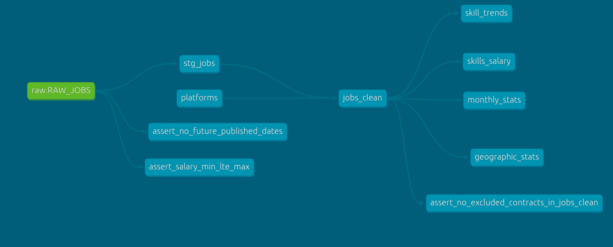
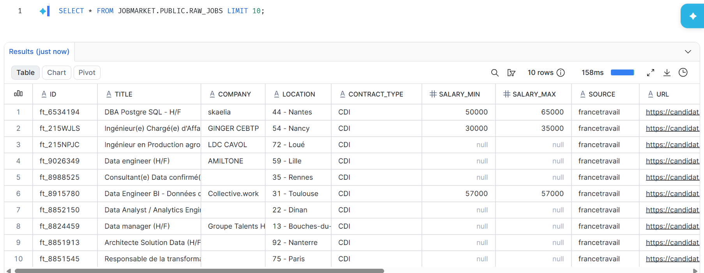
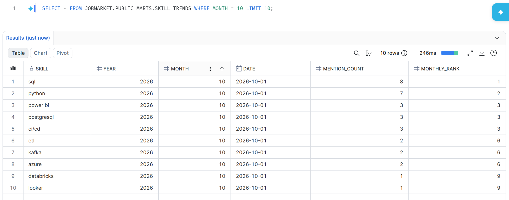
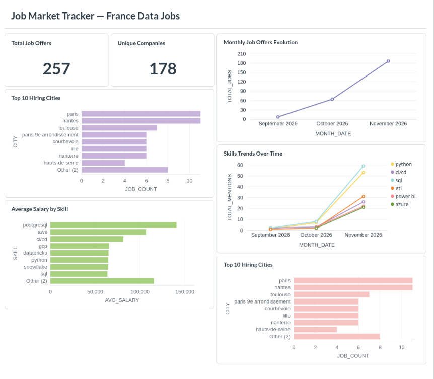

# Job Market Tracker

## Overview
This project is an end-to-end data engineering pipeline that monitors the French tech job market by collecting and analyzing job offers from the **France Travail API**.

It implements an automated data pipeline built around three core stages:
- **Orchestration & Ingestion:** Automated data collection with Python and Apache Airflow, including salary normalization and technical skill extraction.
- **Storage & Transformation:** Data storage in Snowflake and transformation using dbt.
- **Analytics & BI:** Business insights delivered through an interactive Metabase dashboard.

---

## Architecture

```mermaid
flowchart LR
    direction LR

    API["🌐 France Travail API"]
    Airflow["🚀 Apache Airflow"]
    Metabase["📊 Metabase Dashboard"]

    subgraph Snowflake ["❄️ Snowflake Cloud Data Warehouse"]
        direction LR
        Raw[("📁 RAW_JOBS<br/>(Raw Layer)")]
        dbt[["🛠️ dbt Core<br/>(Transformations)"]]
        Intermediate[("📂 PUBLIC_INTERMEDIATE<br/>(Intermediate Layer)")]
        Marts[("🎯 PUBLIC_MARTS<br/>(Analytics Layer)")]

        Raw --> dbt --> Intermediate --> Marts
    end

    API -->|Ingest| Airflow
    Airflow -->|Load| Raw
    Marts -->|Query| Metabase

    classDef external fill:#f8f9fa,stroke:#343a40,stroke-width:2px,color:#212529,font-weight:bold;
    classDef orchestrator fill:#e8f0fe,stroke:#1a73e8,stroke-width:2px,color:#1557b0,font-weight:bold;
    classDef warehouse fill:#ffffff,stroke:#4a5568,stroke-width:2px,color:#2d3748;
    classDef dbtStyle fill:#fff5f5,stroke:#e53e3e,stroke-width:2px,color:#9b2c2c,font-weight:bold;
    classDef bi fill:#f3f0ff,stroke:#7048e8,stroke-width:2px,color:#5733d6,font-weight:bold;

    class API external;
    class Airflow orchestrator;
    class Raw,Intermediate,Marts warehouse;
    class dbt dbtStyle;
    class Metabase bi;

    style Snowflake fill:#f1f3f5,stroke:#ced4da,stroke-width:2px,stroke-dasharray: 5 5,color:#495057,font-weight:bold;
```



---

## Data Pipeline

### 1. Data Collection – France Travail API
- Collects job offers using multiple search queries (`"data engineer"`, `"ingénieur données"`, `"data analytics engineer"`, `"analytics engineer"`)
- Filters job offers based on the CDI contract type
- Normalizes data into a unified `JobOffer` schema
- Extracts technical skills using **rule-based keyword matching**

> **Note:** Adzuna was initially evaluated as a data source but was not retained. France Travail was selected for its structured job offer data.

### 2. Data Loading – Snowflake (RAW Layer)
- Loads job offers into `RAW_JOBS`
- Uses a temporary staging table and a `MERGE` operation to handle existing records and avoid duplicates

### 3. Data Transformation & Quality
- Transforms raw data using dbt through staging, intermediate, and mart layers
- Applies dbt schema tests and custom data quality tests
- Checks source freshness before building downstream models

---

## Analytics Layer (dbt)

### dbt Lineage Graph



### Models
- **Seeds:** Reference data for job platforms
- **Staging (`stg_jobs`):** Cleans and standardizes raw job data
- **Intermediate (`jobs_clean`):** Curated dataset prepared for analysis
- **Marts:**
  - `monthly_stats` – Monthly hiring and salary metrics
  - `skill_trends` – Technical skill demand over time
  - `skills_salary` – Average salary by technical skill
  - `geographic_stats` – Hiring activity by city

### Data Quality

- **dbt Schema Tests:** Generic tests such as `unique`, `not_null`, and `accepted_values`, where configured in the schema YAML files.
- **Custom dbt Tests:**
  - `assert_no_excluded_contracts_in_jobs_clean.sql` – Checks that excluded contract types are not present in `jobs_clean`.
  - `assert_no_future_published_dates.sql` – Ensures job publication dates are not in the future.
  - `assert_salary_min_lte_max.sql` – Validates salary range consistency.
- **Python Tests (pytest):**
  - `test_salary_parser.py` – Tests salary extraction and parsing.
  - `test_skills.py` – Tests technical skill extraction.
---
## How to Run

### Prerequisites
- Python
- Apache Airflow
- Snowflake account
- France Travail API credentials
- dbt Core with Snowflake adapter
- Metabase (optional, for dashboard visualization)

### 1. Install Dependencies

```bash
pip install -r setup/requirements.txt
```

### 2. Configure Airflow Variables

Create an application through the France Travail API portal to obtain your client ID and client secret.

In the Airflow UI, add the following variables:

```text
FRANCETRAVAIL_CLIENT_ID=your_client_id
FRANCETRAVAIL_CLIENT_SECRET=your_client_secret
```

### 3. Configure Airflow Connection

Create a connection named `jmt_snowflake_default` with:

| Field | Value |
|-------|-------|
| Conn Type | Snowflake |
| Login | Your Snowflake username |
| Password | Your Snowflake password |
| Schema | `PUBLIC` |
| Extra (JSON) | `{"account": "...", "warehouse": "COMPUTE_WH", "snowflake_schema": "PUBLIC"}` |

Make sure the database is configured as `JOBMARKET` in your Snowflake connection settings.

### 4. Configure dbt

Copy `setup/profiles.yml.example` to your dbt profiles directory and update it with your Snowflake credentials.

### 5. Configure Metabase (Optional)

Open Metabase and add a Snowflake database connection:

| Field | Value |
|-------|-------|
| Account name | `your-account.region` (from your Snowflake URL) |
| Username | Your Snowflake username |
| Password | Your Snowflake password |
| Warehouse | `COMPUTE_WH` |
| Database name | `JOBMARKET` |
| Schema | `PUBLIC_MARTS` |

### 6. Run the DAG

- Activate `job_market_tracker` in the Airflow UI.
- Trigger it manually or wait for the daily schedule at **06:00**.

---

## Results

### Airflow DAG


### Snowflake Tables



### Metabase Dashboard


Key visualizations:
- **Market Overview** — total job offers, unique companies, and monthly job offers evolution
- **Top Skills** — 10 most requested technical skills
- **Skills Trends** — evolution of the 5 most requested skills over time
- **Average Salary by Skill** — salary comparison across technical skills
- **Top Hiring Cities** — 10 cities with the highest number of job offers

## Business Insights

This pipeline enables answering questions such as:
- How is demand for data engineering roles evolving month over month?
- Which technical skills (Python, Spark, Airflow…) are most in demand?
- How does demand for specific skills evolve over time?
- Which skills are associated with higher salaries on the French market?
- Which cities have the highest number of Data Engineering job offers?


